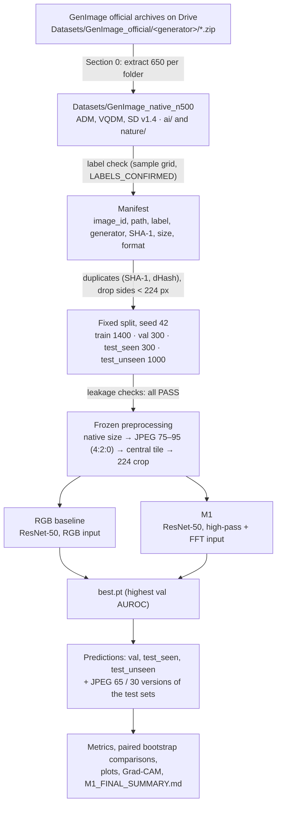

# M1: frequency/noise ResNet-50 detector

**VeriStamp · DATA 255 · Group 7**

M1 decides whether an image is **Real (0)** or **AI-generated (1)** and outputs **P(AI)**. It is an ImageNet-pretrained **ResNet-50** that does not look at the ordinary colour image. Its input is:
- a **high-pass residual**: the fine detail left after blurring is subtracted;
- an **FFT log-magnitude spectrum**: which spatial frequencies the image contains.

The question M1 answers for VeriStamp (RQ1): *do frequency/noise features detect images from a generator the model never saw?* An RGB ResNet-50, trained identically, is the baseline.

- **Full analysis:** experiments, results, shortcut analysis and conclusions are in [`docs/M1_ANALYSIS.md`](docs/M1_ANALYSIS.md).
- **This file:** the final result, how to reproduce it, and what M2/Fusion should reuse.

---

## Final result (`m1_final_n500`)

Setup:
- GenImage subset, 500 images per class per generator (interim level).
- Trained on ADM + VQDM; Stable Diffusion v1.4 held out as the unseen test generator.
- Seed 42, one fold.
- Native 224×224 crops (no resizing) and equal JPEG for Real and AI.

| Test set | n | RGB AUROC | M1 AUROC | M1 − RGB [95% CI] | M1 accuracy | M1 recall (AI caught) |
|---|---|---|---|---|---|---|
| Seen generators (ADM, VQDM) | 300 | 0.947 | 0.937 | −0.010 [−0.033, 0.013] | 0.890 | 0.907 |
| **Unseen Stable Diffusion v1.4** | 1000 | 0.681 | **0.712** | **+0.031 [0.001, 0.059]** | 0.622 | 0.338 |
| Unseen SD after JPEG quality 65 | 1000 | 0.642 | 0.671 | +0.029 [−0.001, 0.058] | 0.570 | 0.220 |
| Unseen SD after JPEG quality 30 | 1000 | 0.578 | 0.585 | +0.007 [−0.025, 0.038] | 0.529 | 0.126 |

**In plain words:**
- M1 is as good as RGB on familiar generators.
- On the unseen generator, M1 is slightly better than RGB. The advantage is small, and its lower bound is near 0.
- Both models still miss most Stable Diffusion images at the default 0.5 threshold.
- Strong JPEG compression removes M1's advantage.

This is one seed and one fold, not a final benchmark. See [Section 10 of the analysis](docs/M1_ANALYSIS.md#10-final-m1-conclusion).

---

## End-to-end pipeline



---

## Reproducibility

### What you need
- A Google account with the GenImage archives in Drive at `MyDrive/Datasets/GenImage_official/`, in folders named `ADM/`, `VQDM/` and `stable_diffusion_v_1_4/`, containing the official multi-part zip files (for example `imagenet_ai_0508_adm.z01 … .zip`).
  - Get them from the official source <https://github.com/GenImage-Dataset/GenImage> (Google Drive link, or Baidu mirror with share code `ztf1`). No passwords or API keys are needed.
  - Only the selected images are extracted; the archives are never fully unpacked.
- The `m1_run_001` reference split at `MyDrive/VeriStamp/data/splits/genimage_unseen-stable_diffusion_v_1_4_n200_seed42/`. Keep it there for an exact reproduction: the final split reuses its Stable Diffusion test images.
- **Google Colab with an A100 GPU** (all runs used an NVIDIA A100-SXM4-80GB, bfloat16 mixed precision).
  - Training takes under a minute per model at 500 per class.
  - Extracting the images (Section 0) and the JPEG-degradation caches take longer.
  - The notebook also runs on CPU (batch size 8), which is enough for the sanity checks but not for real training.

### Steps
1. Open `notebooks/M1_final_n500.ipynb` in Colab. Choose **Runtime → Change runtime type → A100 GPU**.
2. Run **Section 0**:
   - it mounts Drive, checks which generators exist (VQDM replaces BigGAN), and extracts 650 images per image folder into `MyDrive/Datasets/GenImage_native_n500/`;
   - it stops at **0.11**. Look at the sample grid in **0.9** (AI images should look generated, Real ones like photos), set `LABELS_CONFIRMED = True`, and rerun 0.11 and 0.12.
3. Run **Sections 1–27** in order. Nothing else needs editing.
4. Check these outputs:

| Section | Expected |
|---|---|
| 7 | Every leakage check PASS. Split sizes 1400 / 300 / 300 / 1000 |
| 7b | "Every usable m1_run_001 unseen image is in test_unseen": PASS (391 of 400) |
| 14 | ALL SANITY CHECKS PASSED |
| 27 | ALL CHECKS PASSED |

If a Colab session fails with `GET was unable to find an engine` at the first convolution, the runtime's cuDNN library is broken. Disconnect and delete the runtime, reconnect, and rerun from Section 1.

### Configuration (final run)

| Setting | Value |
|---|---|
| `EXPERIMENT` / run name | `m1_final_n500` |
| `DATA_ROOT` | `/content/drive/MyDrive/Datasets/GenImage_native_n500` |
| `PROJECT_DIR` | `/content/drive/MyDrive/VeriStamp` |
| `N_PER_CLASS` | 500 (subset level `interim`) |
| Seed | 42 |
| Generators | Seen ADM, VQDM; unseen `stable_diffusion_v_1_4` |
| Split fractions (seen) | train 0.70, val 0.15, test_seen 0.15; oversample 1.3; near-duplicates dropped |
| Preprocessing | `mode: native`, `crop_size: 224`, `tile_size: 256`, `align: 8`, `jpeg_quality_range: [75, 95]`, `jpeg_subsampling: 4:2:0`, `min_side: 224`, `train_hflip: True`, no random rescale |
| Features | high-pass Gaussian kernel 5, σ 1.0; scale statistics from 20 training batches |
| Model | ResNet-50, `IMAGENET1K_V2` weights, dropout 0.3; modes `rgb` and `hp_fft` |
| Training | ≤ 10 epochs, batch 64, AdamW (lr 1e-4 backbone, 1e-3 new layers, weight decay 1e-4), 1 warm-up epoch + cosine, early stop patience 3 |
| Sanity | overfit 32 images (80 steps), shuffled labels (512 images, 2 epochs) |
| JPEG degradation | qualities 65 and 30, 4:2:0, on `test_seen` and `test_unseen` |
| Grad-CAM | layer `backbone.layer4`, 4 examples per group, 64 images per average |

Every run saves its full configuration, plus the environment and split fingerprints, as `config.yaml` in each model folder.

### Run names

| Run | Executed notebook | In git? | Role |
|---|---|---|---|
| `m1_run_001` | `M1_run001_executed.ipynb` | No (kept locally / Drive) | Original baseline (resize; ADM + BigGAN) |
| `m1_random_rescale` | `M1_random_rescale.ipynb` | No | Random-rescale attempt (M1 only) |
| `m1_resize_vqdm` | `M1_resize_vqdm_executed.ipynb` | No | Control: VQDM replaces BigGAN, old resize |
| `m1_native_crop_equal_jpeg` | `M1_native_crop_equal_jpeg_executed.ipynb` | No | Native crop + equal JPEG, 200 per class |
| **`m1_final_n500`** | `M1_final_n500_executed.ipynb` | **Yes, as evidence** | **Final M1**, 500 per class |

Two final-run notebooks are in git:
- **`notebooks/M1_final_n500_executed.ipynb`** is the evidence: the actual run with all outputs (metrics, plots, Grad-CAM, final verification). Read it; don't rerun it.
- **`notebooks/M1_final_n500.ipynb`** is the one to run. It has the same code with outputs cleared and `LABELS_CONFIRMED = False`, so the label check is not skipped.

The four earlier runs are summarised in [`docs/M1_ANALYSIS.md`](docs/M1_ANALYSIS.md), and their result files are on Drive.
- Each run writes to its own folders. Earlier runs are recorded in a snapshot and checked as unchanged at the end.
- Never reuse a run name for new settings. Choose a new `EXPERIMENT` name instead.

### Resuming an interrupted run
- `last.pt` is saved after every epoch.
- To continue the **same** experiment after a disconnect: set `RESUME = True` in Section 1 (same `EXPERIMENT`), then rerun from Section 1.
  - The split is reloaded (fingerprints verified).
  - The caches are copied back from Drive.
  - Training continues from the next epoch.
- Leave `RESUME = False` for a fresh run. If the run folder already exists, the notebook stops with `FileExistsError` instead of overwriting it.

### Where everything is saved (Google Drive)

```
MyDrive/VeriStamp/
├── data/splits/genimage_seen-ADM-VQDM_unseen-stable_diffusion_v_1_4_min224_n500_seed42__m1_final_n500/
│   ├── manifest.csv  split_info.json  train.csv  val.csv  test_seen.csv  test_unseen.csv
│   └── leakage_checks.csv  reference_unseen_missing.csv
├── data/manifests/m1_final_n500/          dropped_too_small.csv, cross_archive_duplicates.csv, ...
├── cache/<split name>/                     {train,val,test_seen,test_unseen}_native256.npy (preprocessed crops)
├── vslib_m1_final/                         the Python modules the notebook wrote (vs_*.py)
└── experiments/
    ├── experiments_log.csv                 one row per trained model, all runs
    └── m1_final_n500/
        ├── README.md  results_summary.csv/.md  generalization_gap.csv
        ├── M1_FINAL_SUMMARY.md  m1_final_summary.json  final_verification.json  protected_snapshot.json
        ├── plots/roc_comparison.png  data_plots/
        ├── data_checks/                    jpeg_audit.csv, jpeg_checks.csv, crop_coverage.csv, original_info_<split>.csv
        ├── comparison/                     comparison_results.csv/.md, comparison_pairs.csv, comparison_plots.png
        ├── jpeg_degradation/               degradation_results.csv, degradation_pairs.csv, degradation_auroc.png
        ├── gradcam/                        gradcam_<group>.png ×5, gradcam_average.png/.csv, gradcam_images.csv
        ├── rgb/                            (same files as hp_fft/)
        └── hp_fft/                         M1
            ├── config.yaml  best.pt (94 MB)  last.pt  history.csv  metrics.json  README.md
            ├── predictions_val.csv  predictions_test_seen.csv  predictions_test_unseen.csv
            ├── predictions_test_seen_jpeg65.csv  predictions_test_seen_jpeg30.csv
            ├── predictions_test_unseen_jpeg65.csv  predictions_test_unseen_jpeg30.csv
            ├── unseen_test_log.json  shortcut_diagnostic.json (17b)
            ├── diagnostics/                17c: by_original_format.csv, real_by_original_jpeg_quality.csv, ...
            └── plots/                      history.png, roc.png, pr.png, confusion_*.png, scores_*.png,
                                            examples_correct_unseen.png, examples_incorrect_unseen.png
```

Not in git:
- Checkpoints and data are git-ignored and live only on the team Drive.
- The repository's `models/m1_resnet.py` is still a stub. The working M1 code is the `vs_*.py` library the notebook writes (copied to `VeriStamp/vslib_m1_final/`). Moving it into the repository is still to do.

### How a teammate reproduces it
1. Ask for access to the team Drive folders `Datasets/GenImage_official/` and `VeriStamp/data/splits/genimage_unseen-stable_diffusion_v_1_4_n200_seed42/`, or download the three generator archives from the official source into the same layout.
2. Run `notebooks/M1_final_n500.ipynb` exactly as in [Steps](#steps), in **your own Drive**.

   Do not point `PROJECT_DIR` at someone else's finished `m1_final_n500` folder: the notebook will refuse to overwrite it.
3. Compare your Section 19 and Section 23 tables with the final-result table above.

   The data sampling is seeded (42), so you should get the same split. Small differences in the last decimals of the metrics are possible because GPU training is not bit-for-bit deterministic. This was not measured.

---

## Handover for M2 and Fusion

The aim is that M2 and Fusion are compared with M1 on **exactly the same images, labels and preprocessing**.

| Item | Where | How to reuse it |
|---|---|---|
| **Manifest** | `data/splits/<final split>/manifest.csv` | One row per image: `image_id`, `image_path`, `label`, `generator`, `file_hash` (SHA-1), `width`, `height`, `file_format`, `split`, plus status columns. Do not rebuild it |
| **Fixed split** | `train.csv`, `val.csv`, `test_seen.csv`, `test_unseen.csv`, `split_info.json` | Use these files as they are. `split_info.json` holds fingerprints; check them before training. Stable Diffusion v1.4 must never appear in training or validation |
| **Labels** | `label` column | **Real = 0, AI = 1**. Detectors output P(AI) |
| **Preprocessing** | `vs_native.py` in `vslib_m1_final/`; caches in `cache/<final split>/*_native256.npy` | Same frozen pipeline: native size, JPEG 75–95 (4:2:0, seeded by image ID), central 256 tile aligned to 8. Training: random 224 crop + flip; evaluation: centre 224 crop. Images are 0..1 float tensors; each model normalises internally (CLIP needs its own normalisation and input size inside M2) |
| **M1 checkpoint** | `experiments/m1_final_n500/hp_fft/best.pt` (RGB: `rgb/best.pt`) | A dict with `model` (state dict), `epoch`, `val_metrics`, …. Load with `vs_models.build_detector("hp_fft", CONFIG)` + `load_state_dict(ck["model"])`, as the notebook's `load_best()` does. The reload reproduces the validation AUROC exactly (0.9518) |
| **M1 predictions** | `hp_fft/predictions_{val,test_seen,test_unseen}.csv` (+ `_jpeg65`, `_jpeg30` for the test sets) | Columns: `split`, `image_id`, `image_path`, `generator`, `label`, `logit`, `p_ai`, `pred`, `model`, `correct`, `cache_index`. Join with M2 on `image_id` |
| **2048-d feature vectors** | **Not saved yet** | `model(x)["features"]` returns them (shape [B, 2048]), but no run wrote them to disk. They need one extraction pass (sketch below) |
| **Evaluation code** | `vs_metrics.py`; Sections 19, 23 and 24 of the final notebook | `classification_metrics(labels, p_ai)` gives accuracy, AUROC, precision, recall, F1 and the confusion matrix at 0.5. Section 23 has the paired bootstrap AUROC comparison (2,000 resamples, stratified). Section 24 has the JPEG 65/30 test |
| **Metrics and plots** | `metrics.json`, `results_summary.csv`, `comparison/`, `jpeg_degradation/`, `gradcam/`, `plots/` | M1 reference numbers for the RQ1 table |

**Rules to keep the comparison fair:**
- Any decision threshold (for example for Real / Uncertain / AI) must be chosen on **validation** data only.
- `test_unseen` must not be used for tuning. The Stable Diffusion test set has already been used once for the final preprocessing choice; future decisions should be based on validation data.
- Report M2 and Fusion with the same paired bootstrap against M1 on the same images.

### Extracting the 2048-d features (not yet run)
An **untested sketch**, to run inside the final notebook after Section 16 (it uses the notebook's `load_best`, `LOADERS`, `SPLITS`, `RUN_DIRS` and `DEVICE`).
- It uses the **un-augmented** training loader (`train_eval`), so training features match how test images look.
- It writes into `m1_final_n500/hp_fft/features/` only.

```python
import numpy as np, torch

FEAT_DIR = RUN_DIRS["hp_fft"] / "features"
FEAT_DIR.mkdir(exist_ok=True)
model, _ = load_best("hp_fft")                      # M1 best.pt, eval mode
for split in ["train_eval", "val", "test_seen", "test_unseen"]:
    feats, idx = [], []
    with torch.no_grad():
        for b in LOADERS[split]:
            out = model(b["x"].to(DEVICE))           # float32: no autocast
            feats.append(out["features"].cpu().numpy())
            idx.append(b["idx"].numpy())
    feats, idx = np.concatenate(feats), np.concatenate(idx)
    order = np.argsort(idx)                          # row order of the split CSV
    np.save(FEAT_DIR / f"features_{split}.npy", feats[order].astype(np.float32))
    print(split, feats.shape)                        # expect (n_images, 2048)
```

Before relying on it, check that row *i* of each file matches row *i* of the split CSV (`train_eval` corresponds to `train.csv`).

---

## Evidence

Every number in this file and in `docs/M1_ANALYSIS.md` comes from the printed outputs of:
- `notebooks/M1_run001_executed.ipynb`
- `notebooks/M1_random_rescale.ipynb`
- `notebooks/M1_resize_vqdm_executed.ipynb`
- `notebooks/M1_native_crop_equal_jpeg_executed.ipynb`
- `notebooks/M1_final_n500_executed.ipynb` (committed to git; the other four are not), especially:
  - Section 19 (metrics);
  - Section 23 (paired comparisons across all runs);
  - Section 24 (JPEG degradation);
  - Section 25 (Grad-CAM);
  - Section 26 (`M1_FINAL_SUMMARY.md`);
  - Section 27 (final verification: ALL CHECKS PASSED).

These outputs are generated from the saved Drive files (`metrics.json`, `predictions_*.csv`, `comparison/*.csv`, `jpeg_degradation/*.csv`, `gradcam/gradcam_average.csv`). The Drive files themselves were not opened separately when writing this document.
