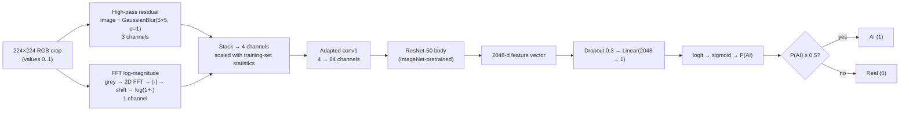

# M1 analysis: frequency/noise ResNet-50 detector

**VeriStamp · DATA 255 · Group 7 · M1 workstream**
Companion file: [`README_M1.md`](../README_M1.md) covers how to reproduce M1 and what to reuse for M2 and Fusion.

> **How to read this document**
> - Every number here comes from the printed outputs of the five executed M1 notebooks (listed in [Evidence](#evidence)). Those outputs are generated from the saved `metrics.json`, `predictions_*.csv` and comparison files of each run.
> - **Subset level.** Four runs used the **debug** subset (200 images per class per generator). The final run used the **interim** subset (500 per class). The proposal's final target of 3,000–5,000 per class was **not** run.
> - Every result is **one seed (42)** and **one leave-one-generator-out fold** (Stable Diffusion v1.4 held out). Read them as interim evidence, not as final benchmark numbers.

---

## Short answer

| Question | Answer (final run `m1_final_n500`) |
|---|---|
| Final recommended model | M1 checkpoint `experiments/m1_final_n500/hp_fft/best.pt` |
| Does M1 beat the RGB baseline on unseen Stable Diffusion? | **Yes, by a small margin.** AUROC 0.712 vs 0.681. Paired difference +0.031, 95% interval [0.001, 0.059] |
| On the seen generators (ADM, VQDM)? | No detectable difference. AUROC 0.937 vs 0.947, difference −0.010 [−0.033, 0.013] |
| Is the unseen result good in absolute terms? | **No.** At threshold 0.5, M1 detects only 33.8% of Stable Diffusion images (recall 0.338) |
| After JPEG compression? | Both models lose AUROC. At quality 30, M1's advantage is gone (+0.007 [−0.025, 0.038]) |
| Did native cropping improve unseen results? | Not significantly by itself (200-per-class runs). It strongly improved the seen results and removed the resizing shortcut, which made the RGB vs M1 comparison fair |

---

## 1. Project goal

### What M1 is supposed to do
M1 is a binary image classifier. It takes an image and outputs **P(AI)**, the probability that the image was made by an AI generator. Labels are **Real = 0, AI = 1**. An image is classified as AI when P(AI) ≥ 0.5.

M1 does not look at the ordinary colour image. It looks at two "forensic" views of it:
- a **high-pass residual**: the fine detail left after removing the smooth content;
- an **FFT magnitude spectrum**: how strongly each spatial frequency (each repeating pattern size) is present.

The idea is that generators leave traces in fine detail and in frequencies that people cannot see. Those traces might be more similar across different generators than the image content is.

### Why detect AI-generated images
Generated images can be photorealistic and are easy to spread. A detector is useful only if it also works on generators it was **not trained on**, because new generators appear all the time. That is why the main M1 number is accuracy on an **unseen** generator, not on the generators used for training.

### How M1 fits into VeriStamp
VeriStamp (see the repository [`README.md`](../README.md)) detects whether an image is Real, AI or Uncertain, and stores that verdict as an invisible watermark.

| Part | Role | Relation to M1 |
|---|---|---|
| **M1** (this document) | ResNet-50 on high-pass + FFT inputs | Answers the frequency/noise side of **RQ1**: do frequency/noise features generalise to unseen generators? |
| M2 | Frozen CLIP + MLP (semantic features) | Must use the **same split and labels** as M1 so RQ1 compares like with like |
| Fusion | Combines M1 and M2 | Will use M1's **2048-dimensional feature vector** and/or its P(AI) |
| M3 | Learned watermark | Uses detector verdicts. RQ3 asks whether the watermark changes M1's prediction |

This document covers **M1 only**. M2, Fusion and M3 were not implemented in this work.

---

## 2. Dataset

### Source
**GenImage**: M. Zhu et al., *GenImage: A Million-Scale Benchmark for Detecting AI-Generated Image*, NeurIPS 2023 Datasets and Benchmarks.
- Repository: <https://github.com/GenImage-Dataset/GenImage>
- The official archives were stored in Google Drive under `Datasets/GenImage_official/<generator>/` as multi-part zip files. Only a small random subset was extracted from them. The full million-image dataset was never downloaded or unpacked.

| Generator folder | Archive | Archive parts | Archive size | Images in its `train/ai` folder |
|---|---|---|---|---|
| ADM | `imagenet_ai_0508_adm.zip` | 13 | 38.8 GB | 162,000 |
| BigGAN | `imagenet_ai_0419_biggan.zip` | 8 | 24.2 GB | 162,000 |
| VQDM | `imagenet_ai_0419_vqdm.zip` | 12 | 38.2 GB | 162,000 |
| stable_diffusion_v_1_4 | `imagenet_ai_0419_sdv4.zip` | 30 | 96.4 GB | 162,000 |

### The four generators

| Generator | Type (from the GenImage paper) | AI image file | Used in |
|---|---|---|---|
| **ADM** | Diffusion model (guided diffusion) | PNG, 256×256 | All runs (seen) |
| **BigGAN** | Generative adversarial network (GAN) | PNG, **128×128** | `m1_run_001`, `m1_random_rescale` (seen) |
| **VQDM** | Vector-quantised diffusion model | PNG, 256×256 | `m1_resize_vqdm`, `m1_native_crop_equal_jpeg`, `m1_final_n500` (seen; replaces BigGAN) |
| **Stable Diffusion v1.4** | Latent text-to-image diffusion model | PNG, **512×512** | All runs (**unseen**: test only) |

### AI images vs Real ("nature") images
Each GenImage generator archive has two classes:
- `ai/`: images made by that generator, **label 1**;
- `nature/`: real photographs from ImageNet, **label 0**.

The two classes differ in more than "real or generated". That matters a lot (see [Section 9](#9-shortcut-analysis)):

| Property | AI images | Real images |
|---|---|---|
| File format | Always PNG (lossless) | Always JPEG (lossy compression) |
| Size | One fixed size per generator (128, 256 or 512 px square) | Varied. Median 500×375; checked sizes from 48×80 to over 3,000 px on a side |
| Colour mode | RGB (ADM: RGBA) | Mostly RGB, a few greyscale (`L`) |

### Images used per experiment

| Experiment | Dataset folder (Drive) | Extracted per image folder | Images in folder | Candidates sampled | Excluded as too small (< 224 px) | Used in the split |
|---|---|---|---|---|---|---|
| `m1_run_001` | `Datasets/GenImage` | 260 | 3,120 | 1,560 | none (no size rule yet) | 1,200 |
| `m1_random_rescale` | `Datasets/GenImage` | (same) | 3,120 | (same split as `m1_run_001`) | none | 1,200 |
| `m1_resize_vqdm` | `Datasets/GenImage_native_crop` | 260 | 3,120 | 1,560 | 40 | 1,200 |
| `m1_native_crop_equal_jpeg` | `Datasets/GenImage_native_crop` | (same) | 3,120 | (same split as `m1_resize_vqdm`) | 40 | 1,200 |
| `m1_final_n500` | `Datasets/GenImage_native_n500` | 650 | 7,800 | 4,102 | 100 | 3,000 |

"Candidates" = the images sampled and hashed before splitting. 1.3× the needed number was sampled, so excluded images could be replaced. In `m1_final_n500`, 202 of the candidates are `m1_run_001` Stable Diffusion test images that were added on purpose (see [Section 3](#pinned-stable-diffusion-test-images)).

### Folder structure
Each working dataset folder mirrors the archive layout (example: the final run):

```
Datasets/GenImage_native_n500/            7,800 images
├── ADM/imagenet_ai_0508_adm/
│   ├── train/ai/        650   (label 1)
│   ├── train/nature/    650   (label 0)
│   ├── val/ai/          650   (label 1)
│   └── val/nature/      650   (label 0)
├── VQDM/imagenet_ai_0419_vqdm/           (same four folders)
├── stable_diffusion_v_1_4/imagenet_ai_0419_sdv4/   (same four folders)
├── DATASET_SUMMARY.csv, DATASET_README.md, DATASET_SETUP.json
```

GenImage's own `train/` and `val/` folders are **not** our splits. Both are pooled per generator and class, and our split is built from that pool ([Section 3](#3-data-splitting)).

### Labels
Folder-to-label rules were proposed automatically (`ai` → 1, `nature` → 0) and then confirmed by a person after viewing a grid of sample images (`LABELS_CONFIRMED = True`). All 12 folders in every run were mapped: Real = 0, AI = 1.

---

## 3. Data splitting

### Four splits

| Split | Contains | Used for |
|---|---|---|
| `train` | Seen generators, 70% | Learning the weights |
| `val` | Seen generators, 15% | Choosing the best epoch (highest validation AUROC) and early stopping |
| `test_seen` | Seen generators, 15% | Accuracy on familiar generators, never used for training |
| `test_unseen` | **Only** the held-out generator (AI images + its Real images) | The main question: does the detector work on a generator it never saw? |

The 70/15/15 split is done separately for each generator and class, so every split is balanced (Real = AI).

### Leave-one-generator-out
"Leave one generator out" means one AI generator is removed completely from training and validation and used only for testing. In every M1 run, the held-out generator was **Stable Diffusion v1.4**.

| Experiment | Seen generators (train / val / test_seen) | Unseen generator (test_unseen only) |
|---|---|---|
| `m1_run_001` | ADM, BigGAN | Stable Diffusion v1.4 |
| `m1_random_rescale` | ADM, BigGAN | Stable Diffusion v1.4 |
| `m1_resize_vqdm` | ADM, VQDM | Stable Diffusion v1.4 |
| `m1_native_crop_equal_jpeg` | ADM, VQDM | Stable Diffusion v1.4 |
| `m1_final_n500` | ADM, VQDM | Stable Diffusion v1.4 |

**Why Stable Diffusion was the unseen generator.**
- It is the most different from the training generators: a text-to-image latent diffusion model at 512×512, while ADM, BigGAN and VQDM are ImageNet class-conditional models at 128–256 px. Generalising to it is the hard, realistic case.
- It was also used as the unseen generator in `m1_run_001`, and keeping it fixed allowed later runs to be compared on the same test images.
- Only one fold was run. The proposal's other folds (holding out each generator in turn) were not run.

### Exact split sizes

**200 per class** (`m1_run_001`, `m1_random_rescale`, `m1_resize_vqdm`, `m1_native_crop_equal_jpeg`). For `m1_run_001`/`m1_random_rescale`, read BigGAN where it says VQDM.

| Split | ADM AI | ADM Real | VQDM (or BigGAN) AI | VQDM (or BigGAN) Real | SD AI | SD Real | Total |
|---|---|---|---|---|---|---|---|
| train | 140 | 140 | 140 | 140 | 0 | 0 | 560 |
| val | 30 | 30 | 30 | 30 | 0 | 0 | 120 |
| test_seen | 30 | 30 | 30 | 30 | 0 | 0 | 120 |
| test_unseen | 0 | 0 | 0 | 0 | 200 | 200 | 400 |

**500 per class** (`m1_final_n500`):

| Split | ADM AI | ADM Real | VQDM AI | VQDM Real | SD AI | SD Real | Total |
|---|---|---|---|---|---|---|---|
| train | 350 | 350 | 350 | 350 | 0 | 0 | 1,400 |
| val | 75 | 75 | 75 | 75 | 0 | 0 | 300 |
| test_seen | 75 | 75 | 75 | 75 | 0 | 0 | 300 |
| test_unseen | 0 | 0 | 0 | 0 | 500 | 500 | 1,000 |

Split reuse:
- `m1_random_rescale` reloaded the `m1_run_001` split; its fingerprints were verified.
- `m1_native_crop_equal_jpeg` uses exactly the same images as `m1_resize_vqdm` ("fingerprints match").
- `m1_final_n500` reloaded its own split, which an earlier attempt of the same notebook had created before that attempt stopped at a GPU error (before training). Its fingerprints were verified.

### Pinned Stable Diffusion test images
To make runs comparable on the **same** unseen images, the 400 `test_unseen` images of `m1_run_001` were reused ("pinned") in every later split.
- 9 of the 400 are real photos whose shorter side is below 224 px. From `m1_resize_vqdm` on, such images are excluded because they cannot be cropped to 224 without enlarging them. So **391 of 400** are present in every later split.
- Paired comparisons *between runs* therefore use these **391 shared images** (`test_unseen_shared`).
- `m1_final_n500`'s 1,000 unseen images contain all 391 usable reference images, plus 393 of the 400 unseen images of `m1_native_crop_equal_jpeg`.

### Duplicate, hash, path and leakage checks
**Leakage** means information from the test images reaching training. For example, the same photo in both train and test makes test scores look better than they really are.

| Check | How | Result in every run |
|---|---|---|
| Exact duplicates | **SHA-1 hash** of every file's bytes (a fingerprint: identical files have identical hashes) | 0 duplicates; every candidate `ok` (1,560 or 4,102) |
| Near-duplicates | **dHash**, a 256-bit perceptual hash that stays similar when an image is resized or recompressed. Images within 12 bits are treated as copies | 0 groups |
| Copies across generator archives | Same hashes inside different generators' archives | 0 exact, 0 near-identical (runs from `m1_resize_vqdm` on) |
| Shared file names | File names that appear in more than one folder | 0 |
| Unseen generator absent from train and val | Row count | PASS, 0 rows |
| `test_unseen` AI images only from the unseen generator | Row count | PASS |
| `test_seen` has no unseen-generator images | Row count | PASS |
| No identical file in two splits | SHA-1 | PASS, 0 shared hashes |
| No file hash used twice | SHA-1 | PASS, 0 repeats |
| No image path used twice | Path | PASS |
| Every split has both Real and AI | Labels | PASS |
| No near-identical image in two splits | dHash | PASS, 0 groups |
| No image smaller than 224 px in any split | Size | PASS (runs from `m1_resize_vqdm` on) |
| BigGAN not used | Generator list | PASS (runs from `m1_resize_vqdm` on) |
| Label balance Real = AI per generator and split | Counts | PASS |
| `test_unseen` identical to `m1_run_001` | Image IDs | WARNING by design: 391 of 400 shared (the 9 small images, explained above) |
| Every usable `m1_run_001` unseen image is in `test_unseen` | Image IDs | PASS (`m1_final_n500`) |
| Earlier runs, splits, caches and datasets untouched | File snapshot (size + modification time) | PASS: 3,224 files unchanged (control and main runs); 6,537 files unchanged (final run) |

---

## 4. M1 architecture

### Diagram



### ResNet-50 backbone
**ResNet-50** is a 50-layer convolutional neural network. It is used here with weights pretrained on ImageNet (`IMAGENET1K_V2`), so it starts out already knowing general visual patterns. The final ImageNet classifier is removed. The body turns any input into a **2048-number feature vector**, and a small head (dropout 0.3, then one linear layer) turns that vector into a single score, the **logit**. **Sigmoid**(logit) = P(AI). The model has 23,510,081 parameters.

### RGB baseline
The baseline is the **same** network class with ordinary RGB input (ImageNet normalisation, standard 3-channel first layer). It is trained on the same split, preprocessing, settings and seed as M1. Any difference between the two therefore comes from the **input features**. In the code the baseline is `input_mode = "rgb"` and M1 is `input_mode = "hp_fft"`.

### High-pass features (3 channels)
`residual = image − GaussianBlur(image)`, using a 5×5 Gaussian kernel with σ = 1, separately for each colour channel.
- Blurring keeps the smooth content (shapes, colours).
- Subtracting the blur leaves the fast changes: edges, fine texture, sensor noise and possible generator artefacts.

### FFT / frequency features (1 channel)
The **FFT** (Fast Fourier Transform) rewrites an image as a sum of waves of different sizes and directions. M1 uses:
1. convert to grey;
2. 2D FFT;
3. magnitude |·| (how strong each wave is);
4. `fftshift`, which moves the slow (low-frequency) waves to the centre;
5. `log(1 + ·)` to compress the huge range of values.

Natural photos have energy that fades smoothly from low to high frequencies. Up-sampling layers in generators can add periodic patterns, which show up as bright spots away from the centre.

### How M1 differs from the RGB baseline
- **Input:** 4 channels (3 high-pass + 1 FFT) instead of 3 RGB channels. The channels are scaled with statistics measured on **training images only** (`hp_std`, `fft_mean`, `fft_std`; for example 0.0469, 0.0524, 0.0933 in the final run).
- **First layer:** ImageNet's first convolution expects 3 channels, so it is replaced with a 4-channel one. The high-pass channels copy the pretrained RGB filters. The FFT channel uses their average. All weights are scaled by 3/4 so the layer's output starts at a similar size.
- Everything else (body, head, loss, optimiser, schedule) is identical.

### Outputs
For a batch of B images, `model(x)` returns:

| Key | Shape | Meaning |
|---|---|---|
| `logits` | [B] | Raw score (positive leans AI) |
| `prob` | [B] | P(AI) = sigmoid(logit) |
| `pred` | [B] | 1 if P(AI) ≥ 0.5, else 0 |
| `features` | [B, 2048] | ResNet-50 feature vector, intended for Fusion |

The 2048-d feature vector is produced on every forward pass and was checked in the smoke test (shape (2, 2048)). However, **feature vectors were not saved to disk** in any run; only predictions were saved. See the handover in [`README_M1.md`](../README_M1.md).

### Training settings (identical in all runs)

| Setting | Value |
|---|---|
| Loss | `BCEWithLogitsLoss` (binary cross-entropy on the logit) |
| Optimiser | AdamW; lr 1e-4 for pretrained layers, 1e-3 for new layers (head, adapted conv1); weight decay 1e-4 |
| Schedule | 1 warm-up epoch, then cosine decay |
| Epochs | At most 10; early stopping after 3 epochs without validation-AUROC improvement |
| Batch size | 64 (GPU); 8 on CPU |
| Precision | bfloat16 mixed precision on the A100 |
| Checkpoint | `best.pt` = highest validation AUROC; `last.pt` = every epoch (for resuming) |
| Seed | 42 |
| Hardware | NVIDIA A100-SXM4-80GB on Colab. Training took 0.2–0.4 min per model |

---

## 5. Preprocessing

Every image, Real or AI, goes through **exactly the same steps**. Four versions were used.

### 5.1 Original resize-based preprocessing (`m1_run_001`, also `m1_random_rescale` and `m1_resize_vqdm`)

```
open → RGB → resize shorter side to 256 → centre-crop 256×256
     → JPEG re-encode (quality 75–95, fixed per image) → cache
train: random 224 crop + horizontal flip | val/test: centre 224 crop
```

The JPEG re-encode gives every image, including the PNG AI images, a JPEG history, so "is it a JPEG?" cannot tell the classes apart.

### 5.2 Random rescale (`m1_random_rescale`)
Same as 5.1, plus: each **training** image is resized by a random factor between ×0.5 and ×2 before the 224 crop. The aim was to give every training image a random resampling trace that says nothing about its label. Validation and test images were unchanged; the notebook checked that they were pixel-identical to the baseline pipeline.

### 5.3 Native-resolution crop (`m1_native_crop_equal_jpeg`, `m1_final_n500`)
"Native" means **no resizing at all**: the model sees real pixels at the size the generator or camera produced them.

```
decode at original size (never enlarged; images with a side < 224 px are excluded)
  → JPEG re-encode of the WHOLE image (quality 75–95, seeded by image ID, 4:2:0)
  → store the central tile (up to 256×256, offset aligned to a multiple of 8)
train: random 224 crop + horizontal flip | val/test: centre 224 crop (offset aligned to 8)
```

- **Alignment to 8:** JPEG compresses in 8×8 blocks. Aligning the crop keeps the block grid in the same place for every image, so the crop position cannot create class-dependent block patterns.
- The notebook verified, for every split:
  - no image was enlarged;
  - all images were decoded at original size;
  - validation and test crops are deterministic and aligned to 8;
  - training crops differ between reads (random), as intended.

### 5.4 Equal JPEG preprocessing
All runs re-encode every image as JPEG quality 75–95. From `m1_resize_vqdm` on, the notebook also **audits** that Real and AI images receive identical JPEG treatment:

| Check (final run, 3,000 images) | Result |
|---|---|
| Every image uses 4:2:0 chroma subsampling (colour stored at half resolution, the standard JPEG setting) | PASS (Real and AI both 4:2:0) |
| Same quality → identical quantisation tables for Real and AI | PASS (0 differing) |
| Quality values shared by both classes | PASS (21 of 21) |
| Mean JPEG quality similar (within 3) | PASS (Real 85.2, AI 84.8) |

### Why the preprocessing was changed
The original pipeline made the classes differ in **how they were resized**:
- BigGAN AI images (128 px) were always enlarged to 256;
- Stable Diffusion AI images (512 px) were always shrunk;
- most Real photos (about 500×375) were shrunk slightly;
- a few small Real photos were enlarged.

The model could learn "was this image enlarged?" in place of "is this image AI?". [Section 9](#9-shortcut-analysis) shows the evidence and how it was found. Native cropping removes resizing entirely, and the JPEG audit makes sure compression is the same for both classes.

### Training vs validation/test transforms

| | Training | Validation and test |
|---|---|---|
| Crop | Random 224×224 position inside the stored 256 tile | Centre 224×224 (aligned to 8 in native mode) |
| Flip | Random horizontal flip | None |
| Random rescale | Only in `m1_random_rescale` | Never |
| JPEG | Same fixed per-image quality as at test | Same |

Evaluation transforms are deterministic, so the same image always gets the same prediction.

---

## 6. Experiments performed

Five experiments in order. Each was a separate run folder; earlier runs were never modified.

| # | Run | Date (from notebook) | Subset | Seen | Preprocessing | Models |
|---|---|---|---|---|---|---|
| 1 | `m1_run_001` | 2026-10-26 | debug (200) | ADM, BigGAN | Resize 256 | RGB + M1 |
| 2 | `m1_random_rescale` | 2026-10-27 | debug (200) | ADM, BigGAN | Resize 256 + random rescale (training) | M1 only |
| 3 | `m1_resize_vqdm` | 2026-10-27 | debug (200) | ADM, VQDM | Resize 256 (control) | RGB + M1 |
| 4 | `m1_native_crop_equal_jpeg` | 2026-11-14 | debug (200) | ADM, VQDM | Native crop + equal JPEG | RGB + M1 |
| 5 | `m1_final_n500` | 2026-11-14 | **interim (500)** | ADM, VQDM | Native crop + equal JPEG (frozen) | RGB + M1, plus JPEG degradation and Grad-CAM |

### 6.1 `m1_run_001`: original baseline
- **Purpose:** first end-to-end M1 vs RGB comparison, following the proposal.
- **Settings:** 200 per class; seen ADM + BigGAN; unseen SD v1.4; resize preprocessing (5.1).
- **Result:**
  - Seen AUROC: RGB 0.855, M1 0.813.
  - Unseen AUROC: RGB **0.436**, M1 **0.401**. Both are *below 0.5*, i.e. worse than random guessing on Stable Diffusion.
- **Meaning:** both models learned something that works on the seen generators but goes the wrong way on SD. This led to the shortcut investigation ([Section 9](#9-shortcut-analysis)).

### 6.2 `m1_random_rescale`: M1 with random rescaling
- **Purpose:** test whether randomising the resampling trace in training removes the resizing shortcut.
- **Settings:** as `m1_run_001` (same split), plus random rescale ×0.5–×2 on training images. Only M1 was trained.
- **Result:** seen AUROC 0.810; unseen AUROC **0.418**, still below 0.5. At threshold 0.5 M1 detected only 9 of 200 SD images (recall 0.045).
- **Meaning:** random rescaling did **not** fix the problem ([Section 9](#why-random-rescaling-did-not-fully-solve-it)).

### 6.3 `m1_resize_vqdm`: VQDM control run
- **Purpose:** remove BigGAN (128 px, which cannot be used without enlarging) and replace it with VQDM, while keeping the **old resize preprocessing**. This "control" isolates the effect of the generator change before changing the preprocessing.
- **Settings:**
  - 200 per class; seen ADM + VQDM.
  - Images with a side under 224 px excluded (40 candidates).
  - Resize preprocessing identical to `m1_run_001` (verified: "Control preprocessing identical to m1_run_001: PASS").
  - Replacement priority was VQDM > GLIDE > Wukong; VQDM was available.
- **Result:**
  - Unseen AUROC on the 391 shared images: RGB 0.446 → 0.615 (+0.169 [0.108, 0.227]); M1 0.411 → 0.599 (+0.188 [0.138, 0.239]).
  - Seen AUROC: RGB 0.771, M1 0.722.
  - RGB vs M1: no detectable difference on any split.
- **Meaning:** removing BigGAN removed most of the below-chance behaviour on SD. Seen-generator scores were modest (validation AUROC about 0.72).

### 6.4 `m1_native_crop_equal_jpeg`: native crop + equal JPEG (main run, 200 per class)
- **Purpose:** remove resizing entirely (5.3) and audit equal JPEG (5.4), on exactly the same images as the control run.
- **Settings:** same split as `m1_resize_vqdm`; native preprocessing.
- **Result (paired against the control run):**
  - Seen got much better:
    - RGB val 0.718 → 0.936, test_seen 0.771 → 0.921;
    - M1 val 0.732 → 0.917, test_seen 0.722 → 0.840.
    - All intervals exclude 0.
  - Unseen (391 shared): RGB 0.615 → 0.584 (−0.031 [−0.093, 0.027], not significant); M1 0.599 → 0.649 (+0.050 [−0.005, 0.105], not significant).
  - RGB vs M1 inside this run:
    - unseen: M1 higher, +0.073 [0.024, 0.122];
    - test_seen: M1 lower, −0.081 [−0.146, −0.019].
- **Meaning:**
  - Native crops made the seen task much easier for both models.
  - With resizing removed, M1 generalised to SD better than RGB, at the cost of lower seen accuracy.
  - This preprocessing was then **frozen** for the final run. Later choices were based on validation data only.

### 6.5 `m1_final_n500`: larger final run (500 per class)
- **Purpose:** the final M1 result. The same frozen preprocessing with 2.5× more data, plus JPEG-degradation and Grad-CAM analyses.
- **Settings:**
  - 500 per class (interim level); seen ADM + VQDM; 1,000 unseen SD test images.
  - Seed 42, each model trained once.
- **Result:**
  - Seen: RGB 0.947, M1 0.937 (no detectable difference).
  - Unseen: RGB 0.681, M1 **0.712** (M1 higher, +0.031 [0.001, 0.059]).
  - On the 391 shared SD images, both models improved over the 200-per-class run: RGB +0.070 [0.030, 0.111], M1 +0.052 [0.005, 0.099].
- **Meaning:**
  - More data helped both models.
  - M1's seen-generator deficit from the 200-per-class run disappeared.
  - M1 keeps a smaller but still significant advantage on unseen SD.
  - Details in [Section 7](#7-results).

---

## 7. Results

### Metric glossary
- **Accuracy:** share of all images classified correctly at P(AI) ≥ 0.5.
- **AUROC** (area under the ROC curve): the probability that a random AI image gets a higher P(AI) than a random Real image. 1.0 = perfect ranking, 0.5 = random, below 0.5 = systematically reversed. It does not depend on the 0.5 threshold, so it is the **main metric**.
- **Precision:** of the images called AI, the share that really are AI.
- **Recall** (AI detection rate): of the real AI images, the share called AI.
- **F1:** the harmonic mean of precision and recall.
- **Confusion matrix:** written `[[TN, FP], [FN, TP]]`.
  - TN = Real called Real; FP = Real called AI;
  - FN = AI called Real; TP = AI called AI.
- **Generalisation gap:** seen-test metric minus unseen-test metric. Positive = drop on the unseen generator.
- **95% interval:** paired bootstrap with 2,000 resamples, stratified by class, on the same images. "Excludes 0" means the difference is unlikely to be chance at this sample size.

### 7.1 Final run `m1_final_n500` (interim, 500 per class)

| Model | Split | n | Accuracy | AUROC [95% CI] | Precision | Recall | F1 | Confusion [[TN,FP],[FN,TP]] |
|---|---|---|---|---|---|---|---|---|
| RGB | val | 300 | 0.923 | 0.976 [0.959, 0.988] | 0.926 | 0.920 | 0.923 | [[139, 11], [12, 138]] |
| RGB | test_seen | 300 | 0.877 | 0.947 [0.922, 0.968] | 0.884 | 0.867 | 0.875 | [[133, 17], [20, 130]] |
| RGB | test_unseen (SD) | 1000 | 0.600 | 0.680 [0.646, 0.713] | 0.755 | 0.296 | 0.425 | [[452, 48], [352, 148]] |
| **M1** | val | 300 | 0.903 | 0.952 [0.925, 0.974] | 0.917 | 0.887 | 0.902 | [[138, 12], [17, 133]] |
| **M1** | test_seen | 300 | 0.890 | 0.937 [0.909, 0.963] | 0.877 | 0.907 | 0.892 | [[131, 19], [14, 136]] |
| **M1** | test_unseen (SD) | 1000 | 0.622 | **0.712** [0.681, 0.744] | 0.782 | 0.338 | 0.472 | [[453, 47], [331, 169]] |

Best epochs (highest validation AUROC): RGB epoch 7 (early-stopped after epoch 10), M1 epoch 9.

**RGB vs M1, paired on the same images (AUROC):**

| Split | n | RGB | M1 | M1 − RGB [95% CI] | Verdict |
|---|---|---|---|---|---|
| val | 300 | 0.976 | 0.952 | −0.024 [−0.046, −0.005] | M1 lower |
| test_seen | 300 | 0.947 | 0.937 | −0.010 [−0.033, 0.013] | No detectable difference |
| test_unseen | 1000 | 0.680 | 0.712 | **+0.031 [0.001, 0.059]** | M1 higher |

**Per seen generator** (each AI generator against all 150 Real test images):

| Model | Generator | n AI | Accuracy | AUROC | AI detection rate | Real accuracy |
|---|---|---|---|---|---|---|
| RGB | ADM | 75 | 0.893 | 0.954 | 0.907 | 0.887 |
| RGB | VQDM | 75 | 0.867 | 0.939 | 0.827 | 0.887 |
| M1 | ADM | 75 | 0.902 | 0.955 | 0.960 | 0.873 |
| M1 | VQDM | 75 | 0.867 | 0.919 | 0.853 | 0.873 |

**Generalisation gap (seen − unseen):**

| Model | Accuracy | AUROC | Precision | Recall | F1 |
|---|---|---|---|---|---|
| RGB | 0.277 | 0.266 | 0.129 | 0.571 | 0.450 |
| M1 | 0.268 | **0.225** | 0.095 | 0.569 | 0.420 |

#### JPEG degradation (final run only)
Each test image was compressed **once more** at JPEG quality 65 or 30 (4:2:0), as a sharing platform might do. It then went through the same frozen preprocessing. The trained checkpoints were only scored; nothing was retrained.

| Model | Split | Clean | JPEG 65 | JPEG 30 | AI recall clean → 65 → 30 | Real accuracy clean → 65 → 30 |
|---|---|---|---|---|---|---|
| RGB | test_seen | 0.947 | 0.902 | 0.861 | 0.867 → 0.740 → 0.653 | 0.887 → 0.887 → 0.900 |
| M1 | test_seen | 0.937 | 0.914 | 0.854 | 0.907 → 0.740 → 0.493 | 0.873 → 0.900 → 0.913 |
| RGB | test_unseen | 0.680 | 0.642 | 0.578 | 0.296 → 0.216 → 0.156 | 0.904 → 0.908 → 0.898 |
| M1 | test_unseen | 0.712 | 0.671 | 0.585 | 0.338 → 0.220 → 0.126 | 0.906 → 0.920 → 0.932 |

(The first three result columns are AUROC.)

| Paired comparison (AUROC) | test_seen | test_unseen |
|---|---|---|
| RGB clean → JPEG 65 | −0.044 [−0.067, −0.025] | −0.039 [−0.054, −0.024] |
| M1 clean → JPEG 65 | −0.023 [−0.045, −0.002] | −0.041 [−0.058, −0.024] |
| RGB clean → JPEG 30 | −0.086 [−0.118, −0.057] | −0.103 [−0.125, −0.081] |
| M1 clean → JPEG 30 | −0.083 [−0.121, −0.049] | −0.127 [−0.152, −0.104] |
| M1 − RGB at JPEG 65 | +0.012 [−0.014, 0.039] | +0.029 [−0.001, 0.058] |
| M1 − RGB at JPEG 30 | −0.007 [−0.046, 0.031] | +0.007 [−0.025, 0.038] |

What this shows:
- Compression lowers AUROC for both models on both test sets; every drop's interval excludes 0.
- After compression the models call more images Real: AI recall falls while Real accuracy rises slightly.
- M1's unseen advantage shrinks to an interval touching 0 at quality 65 and disappears at quality 30.
- The high-frequency traces M1 relies on are partly removed by strong compression.

#### Grad-CAM (final run only)
**Grad-CAM** highlights which regions of the 224×224 crop most increased the score of the predicted class. It is read from the last ResNet block (`layer4`, a 7×7 grid) and enlarged to the crop size, so it is coarse.
- Five groups were chosen using M1's predictions: seen AI caught, seen Real correct, unseen AI caught, unseen AI missed, unseen Real called AI.
- Each group has a figure of 4 example images (crop | RGB CAM | M1 CAM).
- Average maps were computed over 64 images per group (47 for "unseen Real called AI", which is all of M1's false positives on SD).
- **Centre share** = the share of the heat inside the central half of the crop; 0.25 means evenly spread.

| Group | RGB centre share | M1 centre share |
|---|---|---|
| Seen AI caught | 0.628 | 0.767 |
| Seen Real correct | 0.323 | 0.397 |
| Unseen AI caught | 0.484 | 0.693 |
| Unseen AI missed | 0.324 | 0.399 |
| Unseen Real called AI | 0.418 | 0.717 |

Observations (descriptive only):
- When a model predicts **AI**, its average map is a compact blob in the centre of the crop; M1's blob is more concentrated than RGB's.
- When it predicts **Real**, the evidence is spread over the whole crop.
- The four "unseen AI missed" examples are SD images with strong regular patterns (organ pipes, zebra stripes, a spider web, fur). Both models gave them P(AI) close to 0.

Four examples are anecdotes, not a measured pattern. Grad-CAM shows *where* the evidence is, not *what* it is. The centre concentration is not explained by this analysis.

### 7.2 All runs: metrics per split

AUROC with 95% interval; other metrics at threshold 0.5.

| Run | Model | Split | n | Acc | AUROC [95% CI] | Prec | Recall | F1 | [[TN,FP],[FN,TP]] |
|---|---|---|---|---|---|---|---|---|---|
| m1_run_001 | RGB | val | 120 | 0.817 | 0.907 [0.847, 0.954] | 0.839 | 0.783 | 0.810 | [[51,9],[13,47]] |
| m1_run_001 | RGB | test_seen | 120 | 0.742 | 0.855 [0.782, 0.912] | 0.738 | 0.750 | 0.744 | [[44,16],[15,45]] |
| m1_run_001 | RGB | test_unseen | 400 | 0.472 | 0.436 [0.381, 0.493] | 0.407 | 0.120 | 0.185 | [[165,35],[176,24]] |
| m1_run_001 | M1 | val | 120 | 0.842 | 0.890 [0.826, 0.947] | 0.887 | 0.783 | 0.832 | [[54,6],[13,47]] |
| m1_run_001 | M1 | test_seen | 120 | 0.742 | 0.813 [0.731, 0.886] | 0.738 | 0.750 | 0.744 | [[44,16],[15,45]] |
| m1_run_001 | M1 | test_unseen | 400 | 0.475 | 0.401 [0.348, 0.455] | 0.414 | 0.120 | 0.186 | [[166,34],[176,24]] |
| m1_random_rescale | M1 | val | 120 | 0.850 | 0.878 | 0.977 | 0.717 | 0.827 | not printed |
| m1_random_rescale | M1 | test_seen | 120 | 0.775 | 0.810 | 0.867 | 0.650 | 0.743 | [[54,6],[21,39]] |
| m1_random_rescale | M1 | test_unseen | 400 | 0.493 | 0.418 | 0.429 | 0.045 | 0.081 | [[188,12],[191,9]] |
| m1_resize_vqdm | RGB | val | 120 | 0.642 | 0.718 [0.625, 0.802] | 0.655 | 0.600 | 0.626 | [[41,19],[24,36]] |
| m1_resize_vqdm | RGB | test_seen | 120 | 0.750 | 0.771 [0.678, 0.852] | 0.759 | 0.733 | 0.746 | [[46,14],[16,44]] |
| m1_resize_vqdm | RGB | test_unseen | 400 | 0.585 | 0.617 [0.561, 0.671] | 0.635 | 0.400 | 0.491 | [[154,46],[120,80]] |
| m1_resize_vqdm | M1 | val | 120 | 0.675 | 0.732 [0.639, 0.818] | 0.672 | 0.683 | 0.678 | [[40,20],[19,41]] |
| m1_resize_vqdm | M1 | test_seen | 120 | 0.642 | 0.722 [0.630, 0.809] | 0.627 | 0.700 | 0.661 | [[35,25],[18,42]] |
| m1_resize_vqdm | M1 | test_unseen | 400 | 0.578 | 0.607 [0.551, 0.662] | 0.594 | 0.490 | 0.537 | [[133,67],[102,98]] |
| m1_native_crop_equal_jpeg | RGB | val | 120 | 0.842 | 0.936 [0.888, 0.972] | 0.873 | 0.800 | 0.835 | [[53,7],[12,48]] |
| m1_native_crop_equal_jpeg | RGB | test_seen | 120 | 0.842 | 0.921 [0.871, 0.963] | 0.887 | 0.783 | 0.832 | [[54,6],[13,47]] |
| m1_native_crop_equal_jpeg | RGB | test_unseen | 400 | 0.545 | 0.585 [0.532, 0.640] | 0.618 | 0.235 | 0.341 | [[171,29],[153,47]] |
| m1_native_crop_equal_jpeg | M1 | val | 120 | 0.808 | 0.917 [0.870, 0.959] | 0.814 | 0.800 | 0.807 | [[49,11],[12,48]] |
| m1_native_crop_equal_jpeg | M1 | test_seen | 120 | 0.758 | 0.840 [0.765, 0.905] | 0.763 | 0.750 | 0.756 | [[46,14],[15,45]] |
| m1_native_crop_equal_jpeg | M1 | test_unseen | 400 | 0.590 | 0.657 [0.603, 0.710] | 0.705 | 0.310 | 0.431 | [[174,26],[138,62]] |
| **m1_final_n500** | RGB | test_seen | 300 | 0.877 | 0.947 [0.922, 0.968] | 0.884 | 0.867 | 0.875 | [[133,17],[20,130]] |
| **m1_final_n500** | RGB | test_unseen | 1000 | 0.600 | 0.680 [0.646, 0.713] | 0.755 | 0.296 | 0.425 | [[452,48],[352,148]] |
| **m1_final_n500** | M1 | test_seen | 300 | 0.890 | 0.937 [0.909, 0.963] | 0.877 | 0.907 | 0.892 | [[131,19],[14,136]] |
| **m1_final_n500** | M1 | test_unseen | 1000 | 0.622 | 0.712 [0.681, 0.744] | 0.782 | 0.338 | 0.472 | [[453,47],[331,169]] |

`m1_random_rescale` was not part of the cross-run comparison table, so its AUROC intervals and validation confusion matrix were not printed.

### 7.3 Per seen generator, all runs (test_seen)

| Run | Model | Generator | Accuracy | AUROC | AI detection rate | Real accuracy |
|---|---|---|---|---|---|---|
| m1_run_001 | RGB | ADM | 0.656 | 0.728 | 0.500 | 0.733 |
| m1_run_001 | RGB | BigGAN | 0.822 | **0.981** | 1.000 | 0.733 |
| m1_run_001 | M1 | ADM | 0.656 | 0.652 | 0.500 | 0.733 |
| m1_run_001 | M1 | BigGAN | 0.822 | **0.973** | 1.000 | 0.733 |
| m1_random_rescale | M1 | ADM | 0.700 | 0.634 | 0.300 | 0.900 |
| m1_random_rescale | M1 | BigGAN | 0.933 | **0.985** | 1.000 | 0.900 |
| m1_resize_vqdm | RGB | ADM | 0.722 | 0.720 | 0.633 | 0.767 |
| m1_resize_vqdm | RGB | VQDM | 0.789 | 0.823 | 0.833 | 0.767 |
| m1_resize_vqdm | M1 | ADM | 0.600 | 0.664 | 0.633 | 0.583 |
| m1_resize_vqdm | M1 | VQDM | 0.644 | 0.781 | 0.767 | 0.583 |
| m1_native_crop_equal_jpeg | RGB | ADM | 0.878 | 0.926 | 0.833 | 0.900 |
| m1_native_crop_equal_jpeg | RGB | VQDM | 0.844 | 0.916 | 0.733 | 0.900 |
| m1_native_crop_equal_jpeg | M1 | ADM | 0.789 | 0.863 | 0.833 | 0.767 |
| m1_native_crop_equal_jpeg | M1 | VQDM | 0.733 | 0.817 | 0.667 | 0.767 |
| m1_final_n500 | RGB | ADM | 0.893 | 0.954 | 0.907 | 0.887 |
| m1_final_n500 | RGB | VQDM | 0.867 | 0.939 | 0.827 | 0.887 |
| m1_final_n500 | M1 | ADM | 0.902 | 0.955 | 0.960 | 0.873 |
| m1_final_n500 | M1 | VQDM | 0.867 | 0.919 | 0.853 | 0.873 |

The only unseen generator is Stable Diffusion v1.4, so its results are the `test_unseen` rows above.

### 7.4 RGB vs M1 inside each run (paired AUROC, M1 − RGB)

| Run | val | test_seen | test_unseen |
|---|---|---|---|
| m1_run_001 | 0.890 vs 0.907 (not paired-tested) | 0.813 vs 0.855 (not paired-tested) | 0.401 vs 0.436 (not paired-tested) |
| m1_resize_vqdm | +0.014 [−0.066, 0.099] | −0.049 [−0.137, 0.037] | −0.010 [−0.063, 0.045] |
| m1_native_crop_equal_jpeg | −0.019 [−0.070, 0.030] | **−0.081 [−0.146, −0.019]** | **+0.073 [0.024, 0.122]** |
| m1_final_n500 | **−0.024 [−0.046, −0.005]** | −0.010 [−0.033, 0.013] | **+0.031 [0.001, 0.059]** |

Bold = the 95% interval excludes 0.

### 7.5 Between runs, on the same 391 Stable Diffusion images (paired AUROC)

| Change | RGB | M1 |
|---|---|---|
| m1_run_001 → m1_resize_vqdm (BigGAN → VQDM) | 0.446 → 0.615, **+0.169 [0.108, 0.227]** | 0.411 → 0.599, **+0.188 [0.138, 0.239]** |
| m1_resize_vqdm → m1_native_crop_equal_jpeg (resize → native) | 0.615 → 0.584, −0.031 [−0.093, 0.027] | 0.599 → 0.649, +0.050 [−0.005, 0.105] |
| m1_native_crop_equal_jpeg → m1_final_n500 (200 → 500 per class) | 0.584 → 0.655, **+0.070 [0.030, 0.111]** | 0.649 → 0.700, **+0.052 [0.005, 0.099]** |

Seen-split changes are paired only where the images are the same (control → native):
- RGB val +0.218 [0.140, 0.303], test_seen +0.150 [0.074, 0.233];
- M1 val +0.185 [0.110, 0.263], test_seen +0.118 [0.029, 0.204].

### 7.6 Generalisation gaps (AUROC, seen − unseen)

| Run | RGB | M1 |
|---|---|---|
| m1_run_001 | 0.419 | 0.411 |
| m1_random_rescale | n/a | 0.392 |
| m1_resize_vqdm | 0.155 | 0.116 |
| m1_native_crop_equal_jpeg | 0.336 | 0.183 |
| m1_final_n500 | 0.266 | 0.225 |

A smaller gap is not automatically better: `m1_resize_vqdm` has small gaps partly because its *seen* scores were low.

---

## 8. Sanity and reliability checks

### Pre-training sanity checks (all runs)

| Check | What it tests | m1_run_001 | m1_random_rescale | m1_resize_vqdm | m1_native_crop_equal_jpeg | m1_final_n500 |
|---|---|---|---|---|---|---|
| **Smoke test**: 2 training steps + 1 validation batch per model; correct output shapes, finite losses | The code runs end to end | PASS (RGB, M1) | PASS (M1) | PASS (RGB, M1) | PASS (RGB, M1) | PASS (RGB, M1) |
| **Overfit 32 images**: train on 32 images for 80 steps | The model can learn at all (should reach ~100%) | PASS, acc 1.000 | PASS, acc 1.000 | PASS, acc 1.000 | PASS, acc 1.000 | PASS, acc 1.000 |
| **Shuffled labels**: train with random labels (512 images, 2 epochs); mean validation AUROC must be 0.40–0.60 | No leakage: with meaningless labels, nothing real can be learned | PASS, 0.500 (A 0.299 / B 0.701) | PASS, 0.500 (0.375 / 0.625) | PASS, 0.500 (0.413 / 0.587) | PASS, 0.500 (0.490 / 0.510) | PASS, 0.500 (0.522 / 0.478) |

The shuffled-label test trains a model A and a "mirror" model B with inverted random labels. Their mean is 0.500 by construction, and each one should stay near chance.

### Data checks

| Check | Result |
|---|---|
| Image readability | 0 corrupted or unreadable files in every run: up to 200 images per folder fully decoded in Section 0, and every hashed candidate opened (0 unreadable) |
| Duplicates (SHA-1, dHash, file names, cross-archive) | 0 in every run ([Section 3](#duplicate-hash-path-and-leakage-checks)) |
| Labels | Folder rules confirmed after a visual check of sample grids; label balance PASS; every split contains both classes |
| Split leakage | All leakage checks PASS in every run |
| Checkpoint reload | Reloaded `best.pt` reproduces the training-time validation AUROC exactly in every run (for example M1 final: 0.9518 = 0.9518) |
| Preprocessing audits | Native: deterministic, aligned, never enlarged (PASS). JPEG audit: PASS (from the control run on) |
| Protected files | Earlier runs, splits, caches and datasets unchanged (PASS) |
| Final verification | `ALL CHECKS PASSED` in `m1_resize_vqdm`, `m1_native_crop_equal_jpeg` (Section 24) and `m1_final_n500` (Section 27), saved as `final_verification.json`. The first two runs did not have this section |

---

## 9. Shortcut analysis

A **shortcut** is a feature that separates the classes in the training data but has nothing to do with the real question. Here, the real question is "is this image generated?". A model that learns a shortcut looks good on familiar data and fails elsewhere.

### How the resizing shortcut was discovered
Three signals in `m1_run_001`:
1. **Below-chance AUROC on Stable Diffusion** (RGB 0.436, M1 0.401). Random guessing gives 0.5. Values clearly below it mean the model ranks SD images as *more Real* than real photos, so it must be using a signal that flips direction on SD.
2. **BigGAN was too easy:**
   - BigGAN AUROC was 0.981 (RGB) and 0.973 (M1), with 100% of BigGAN images caught;
   - ADM AUROC was only 0.728 / 0.652.
3. **The upscaling diagnostic (Section 17b).** The preprocessing table showed:
   - 100% of BigGAN AI images were enlarged (128 → 256);
   - 0% of ADM AI images, and 0–17% of Real photos per group.

   Real photos that had been enlarged received a much higher P(AI):

| Model | Real, enlarged (n = 9) | Real, not enlarged (n = 111) | AI ADM (n = 60) | AI BigGAN (n = 60) |
|---|---|---|---|---|
| RGB | mean P(AI) 0.65 | 0.22 | 0.55 | 0.93 |
| M1 | 0.66 | 0.21 | 0.53 | 0.97 |

### Why the model learned resizing artefacts
Resizing leaves an **interpolation trace**:
- Enlarging invents in-between pixels, which smooths fine detail and removes high frequencies.
- Shrinking keeps real detail.

In `m1_run_001` the trace was tied to the label: all BigGAN AI images were enlarged, almost no Real photos were. "Enlarged → AI" was an easy rule that works on the training data. High-pass and FFT inputs show exactly this kind of frequency change, so M1 was especially exposed to it.

### BigGAN 128×128 vs Stable Diffusion 512×512
- **BigGAN (128 px)** had to be *enlarged* 2× to reach 256.
- **Stable Diffusion (512 px)** had to be *shrunk* 2×. Its images therefore looked "not enlarged", like most real photos.

A model using "enlarged = AI" calls SD images Real. That matches the observed recall of only 0.120 on SD in `m1_run_001` and the below-chance AUROC.

This is the most consistent explanation of the evidence, not a proven cause. The control run supports it: replacing BigGAN with VQDM (256 px, never enlarged) raised unseen AUROC by +0.17 to +0.19.

### PNG vs JPEG
- Every AI image is a lossless PNG; every Real image is a JPEG photo. A detector could learn "has JPEG compression traces → Real".
- Countermeasure: every image is re-encoded as JPEG (quality 75–95), so both classes carry the same JPEG traces. From the control run on, the audit confirmed identical settings ([Section 5.4](#54-equal-jpeg-preprocessing)).
- The Real photos' *original* JPEG quality remains different from image to image. Section 17c measured whether P(AI) for Real photos depends on it (Spearman ρ, where negative = lower original quality looks more AI):

| Run | RGB ρ (p, n) | M1 ρ (p, n) | Notebook verdict |
|---|---|---|---|
| m1_resize_vqdm | −0.062 (0.502, 120) | −0.173 (0.059, 120) | No clear dependence |
| m1_native_crop_equal_jpeg | −0.271 (0.003, 120) | −0.293 (0.001, 120) | P(AI) depends on original JPEG quality: a format shortcut may remain |
| m1_final_n500 | −0.013 (0.817, 300) | −0.093 (0.107, 300) | No clear dependence |

Most Real photos have high original quality (248 of 300 above 92 in the final run). The low-quality groups are small (25 images at quality ≤ 75), so this check has limited power.

### Why random rescaling did not fully solve the problem
The facts:
- `m1_random_rescale` still had below-chance unseen AUROC (0.418).
- Its enlarged Real photos still scored higher (mean P(AI) 0.45 vs 0.15).
- BigGAN was still almost perfectly separated (AUROC 0.985).

How the pipeline explains this:
- The random rescale was applied to **cached images that had already been resized to 256**. BigGAN's original 128 → 256 enlargement was baked in before the random factor was added. A second random resize blurs the trace but does not remove it.
- Validation and test images were never rescaled, so the model was evaluated on exactly the trace it had learned.

### Why native cropping and equal JPEG were introduced
- **Native cropping** removes resizing completely: no image is ever enlarged or shrunk. BigGAN, whose images are smaller than the 224 crop, had to be replaced (by VQDM). Real photos smaller than 224 px are excluded.
- **Equal JPEG** (with audit) makes compression identical for both classes, so the remaining differences should come from how the images were made.

After the change, "Real enlarged" no longer applies (`n = 0` in the 200-per-class native run). In the final run, the 5 Real photos that the *old* pipeline would have enlarged scored mean P(AI) 0.17 (RGB) and 0.22 (M1), vs 0.12 and 0.14 for the others. That group is too small to draw a conclusion from.

### Known limitation: crop coverage differs by source
A 224×224 crop covers a different share of the original image depending on the source:

| Source | Original size (median) | Share of the original covered by one 224 crop |
|---|---|---|
| ADM AI, VQDM AI | 256×256 | 76.6% |
| Real photos (all generators) | 500×375 | 26.8% median (range 0.7%–88.6% in the final run) |
| Stable Diffusion AI | 512×512 | 19.1% |

Objects therefore appear at different scales:
- seen AI crops show almost the whole scene;
- Real and SD crops show a close-up part.

The model could partly learn "whole scene = AI", which would not transfer to SD. This is an **untested hypothesis**. It was recorded as a known limitation in every native run and was not corrected.

---

## 10. Final M1 conclusion

### Final recommended version
**`m1_final_n500`, M1 (`hp_fft`) checkpoint `experiments/m1_final_n500/hp_fft/best.pt`** (epoch 9, validation AUROC 0.952).
- Native 224 crops, no enlargement, equal JPEG (quality 75–95, 4:2:0).
- Seen ADM + VQDM, unseen Stable Diffusion v1.4.
- 500 per class, seed 42.

The preprocessing was frozen before this run. The test sets were only reported, never used for tuning.

### Does M1 beat RGB on unseen Stable Diffusion?
**Yes, slightly, in this one fold and seed.**
- AUROC 0.712 vs 0.681. Paired difference +0.031 with 95% interval [0.001, 0.059]. The lower end is very close to 0, so the advantage is small and fragile.
- It was also positive in the 200-per-class native run (+0.073 [0.024, 0.122]).
- It was **not** present under the resize preprocessing (control: −0.010 [−0.063, 0.045]).
- It does not survive strong compression (JPEG 30: +0.007 [−0.025, 0.038]).
- On seen generators the two models are equal on test_seen; M1 is slightly lower on validation (−0.024).

### Did native cropping improve the result?
- **Seen generators: yes, strongly.** Every paired seen comparison improved; intervals exclude 0 for both models.
- **Unseen Stable Diffusion: not significantly by itself.** RGB −0.031 [−0.093, 0.027], M1 +0.050 [−0.005, 0.105] on the 391 shared images.
- **Indirectly, yes:** it removed the resizing shortcut, and only after that did M1's advantage over RGB on SD appear.
- The improvement from 200 to 500 per class was significant for both models (+0.070 RGB, +0.052 M1).

### What M1 learned successfully
- **Seen generators:** M1 separates ADM and VQDM images from real photos well (test_seen AUROC 0.937; ADM 0.955, VQDM 0.919).
- **Partial transfer:** M1 carries some of that to Stable Diffusion, clearly above chance (0.712, interval [0.681, 0.744]) and a little better than RGB. This supports, weakly, the RQ1 idea that frequency/noise inputs generalise somewhat better than RGB.
- **Real photos are rarely flagged:** M1's Real accuracy on the SD test set is 0.906.

### What M1 did not achieve
- **Most SD images are missed** at threshold 0.5 (recall 0.338). The default threshold was not tuned. A threshold chosen on *validation* data could trade false positives for recall, but this was not done. Any threshold must come from validation, never from test.
- **Not robust to compression:** the advantage disappears at JPEG 30.
- **Limited scope:**
  - one fold;
  - one seed;
  - 500 per class (proposal: 3,000–5,000);
  - no published baselines;
  - the crop-coverage confound is untested.

---

## Evidence

Numbers were taken from the outputs of these executed notebooks in `VeriStamp/notebooks/`. Only `M1_final_n500_executed.ipynb` is committed to git; the other four are kept locally and their result files are on Drive:

| File | Run(s) | Key sections used |
|---|---|---|
| `M1_run001_executed.ipynb` | `m1_run_001` | 0.4–0.11, 5–8 (counts, formats, upscaling table), 14 (sanity), 15–22 (training, metrics, 17b diagnostic) |
| `M1_random_rescale.ipynb` | `m1_random_rescale` | 7 (split reload), 8b (rescale check), 14–22 |
| `M1_resize_vqdm_executed.ipynb` | `m1_resize_vqdm` | 0.2b (replacement generator), 6b (too small), 7–7b, 8c (JPEG audit, crop coverage), 14–22, 23 (comparison), 24 (final verification) |
| `M1_native_crop_equal_jpeg_executed.ipynb` | `m1_native_crop_equal_jpeg` | same as above, plus 8b (native checks), 17c, 23 (paired comparisons) |
| `M1_final_n500_executed.ipynb` | `m1_final_n500` | 0–27, including 23 (all-run comparison), 24 (JPEG degradation), 25 (Grad-CAM), 26 (`M1_FINAL_SUMMARY.md`), 27 (final verification) |

These outputs print the contents of the files saved on Google Drive under `VeriStamp/experiments/<run>/`:
- `metrics.json`, `predictions_*.csv`, `results_summary.csv`;
- `comparison/comparison_results.csv` and `comparison_pairs.csv`;
- `jpeg_degradation/*.csv`, `gradcam/gradcam_average.csv`;
- `M1_FINAL_SUMMARY.md`, `final_verification.json`.

